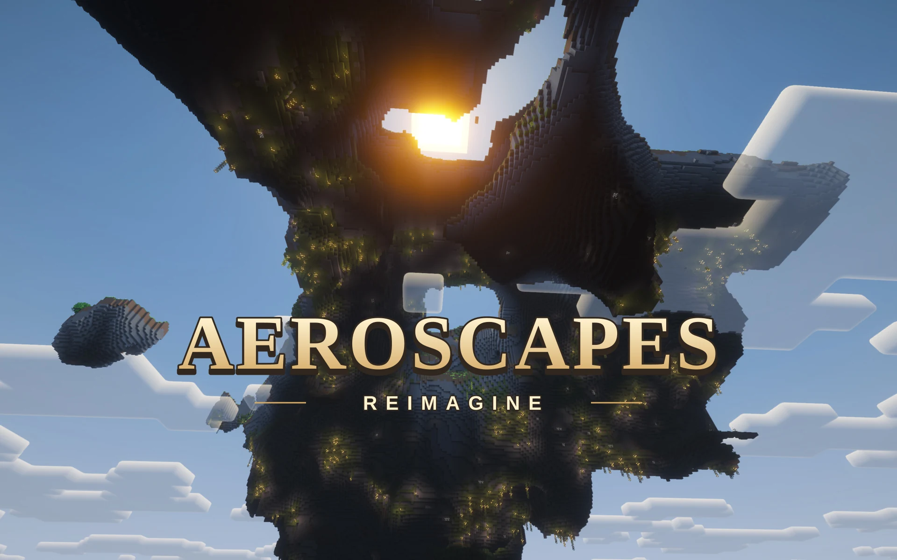
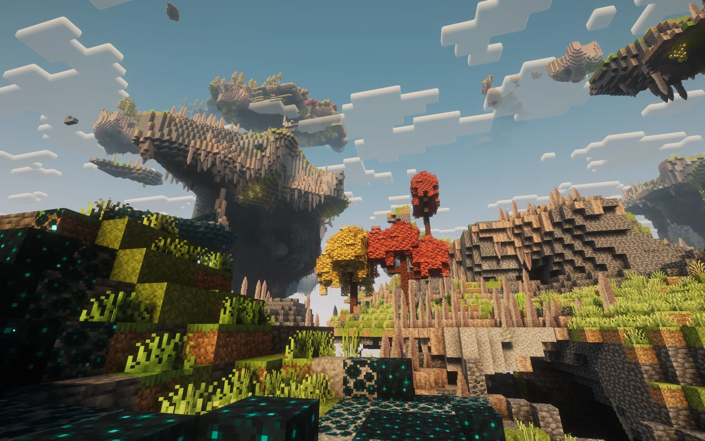
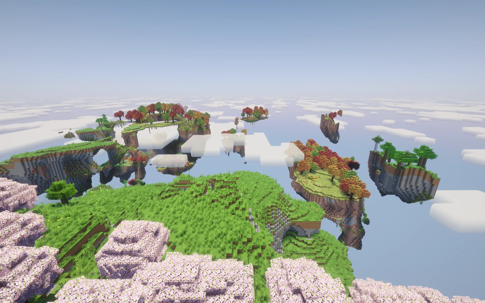
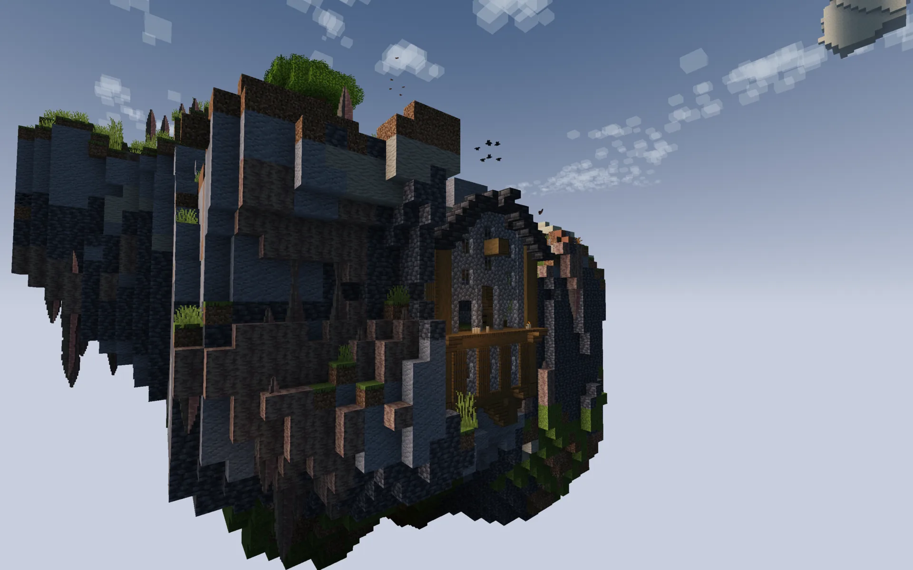

# Aeroscapes Reimagine

[Читать по-русски](README.ru.md)

<!-- description:start -->

**Build an airship. Cross the clouds. Find your next home.**

A singleplayer Minecraft survival sandbox with **Create** and **Create Aeronautics**, set in an Overworld of floating islands.

## 🧭 Explore the islands

- 🏝️ **A world above the void.** Find forests, arid islands, caves and villages perched over sheer drops.
- 🪝 **Glide down or climb up.** Catch an updraft with a paraglider or grapple onto a cliff and mine from the rope.
- 🏕️ **Follow the smoke.** Some survey camps leave directions to a vein of ore. Stay out longer to find a ruin or board a derelict airship.

## 🛠️ Build machines and take flight

- 🛩️ **Fly a ship you built.** Assemble a scout or a cargo airship block by block. Check its lift, pack your supplies, and pick a place to land.
- ⚙️ **Put Create to work.** Run a workshop, automate the parts you use most, and let your machines help stock the next expedition.
- 🐋 **Keep a camera on deck.** Watch for sky whales and photograph them for your Sky Photo Journal.

## 🌿 Make the island yours

- 🍲 **Grow it, cook it, take it with you.** Crossbreed crops, cook with Farmer’s Delight, and pack food for the next trip.
- 🪚 **Build into a cliff.** Make a home or a workshop with new woods, furniture, and details you can carve to fit.
- ✨ **Get better at what you do.** Choose a race and class, practise your skills, reforge gear, and learn spells from scrolls found on your travels.

**Minecraft Java Edition 1.21.1 · NeoForge · Java 25.** Start with a new Default world. [Download](https://github.com/ALittleMoron/aeroscapes-reimagine/releases) · [Installation guide](docs/en/install.md)

Reimagine is an independent project that builds on selected data from Isabel’s Aeroscapes. Otherworld D&D inspired its approach to character progression, combat, and magic. [Isabel’s Aeroscapes](https://modrinth.com/modpack/aeroscapes) · [Otherworld D&D](https://www.curseforge.com/minecraft/modpacks/otherworld-dnd) · [Credits and licenses](docs/en/credits.md)

<!-- description:end -->

[Documentation](docs/en/index.mdx) · [Gallery](docs/en/gallery.mdx) · [Changelog](docs/en/changelog.md) · [Suggestions](docs/en/suggestions.md) · [Development guide](CONTRIBUTING.md)

[Report a bug or suggest an improvement](https://github.com/ALittleMoron/aeroscapes-reimagine/issues/new/choose) · [Project board](https://github.com/users/ALittleMoron/projects/3)

The owner directs the project and accepts changes. AI tools support exploring ideas, researching Minecraft modding, and reviewing code and pack integration. [AI and authorship](docs/en/ai-manifesto.md)
