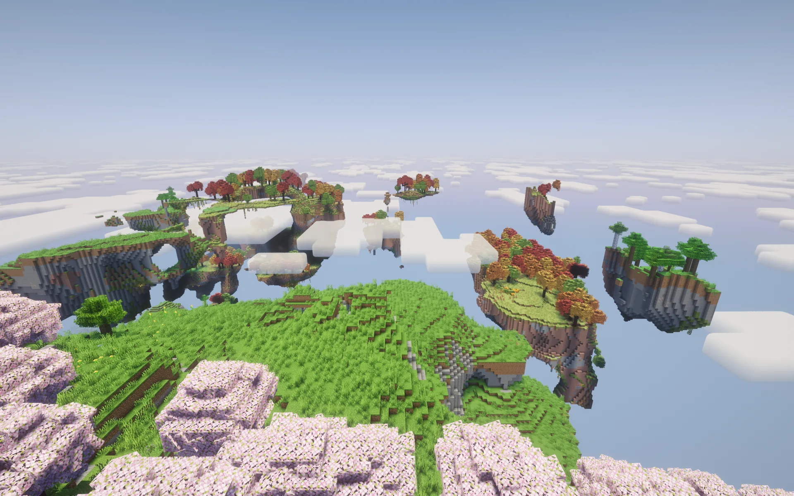

# Aeroscapes Reimagine

Minecraft-песочница с парящими островами, инженерией Create, воздушными кораблями
Aeronautics и развивающимися фэнтезийными системами. Вдохновлена Isabel’s Aeroscapes
и Otherworld D&D. Основной режим — одиночная игра.

A Minecraft sandbox of floating islands, Create engineering, Aeronautics aircraft
and developing fantasy systems. Inspired by Isabel’s Aeroscapes and Otherworld D&D.
The pack is primarily designed for singleplayer.

Автор определяет направление проекта и принимает изменения. ИИ помогает проверять
идеи, исследовать вопросы Minecraft-моддинга и проводить ревью кода и сборки.

The owner directs the project and accepts changes. AI tools support exploring
ideas, researching Minecraft modding, and reviewing code and pack integration.

- [Документация на русском](docs/ru/index.mdx) · [English documentation](docs/en/index.mdx)
- [Галерея](docs/ru/gallery.mdx) · [Gallery](docs/en/gallery.mdx)
- [Манифест об ИИ и авторстве](docs/ru/ai-manifesto.md) · [A manifesto on AI and authorship](docs/en/ai-manifesto.md)
- [История изменений](docs/ru/changelog.md) · [Changelog](docs/en/changelog.md)
- [Development guide](CONTRIBUTING.md) · [Site tooling](tools/docs/README.md)
