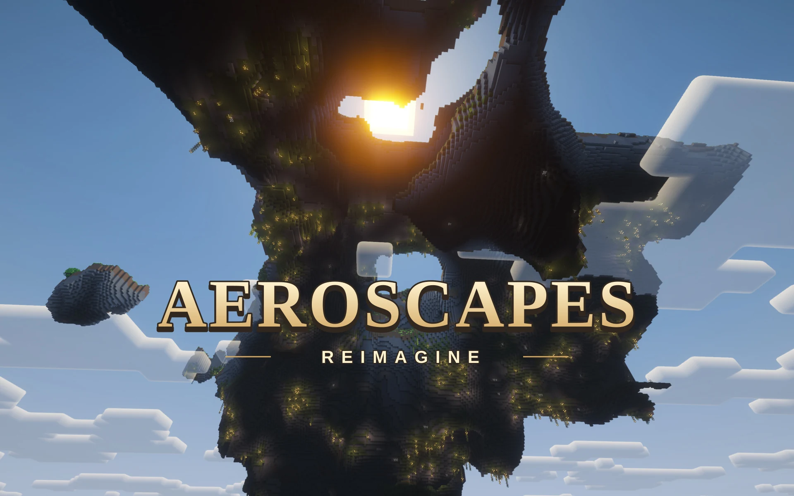
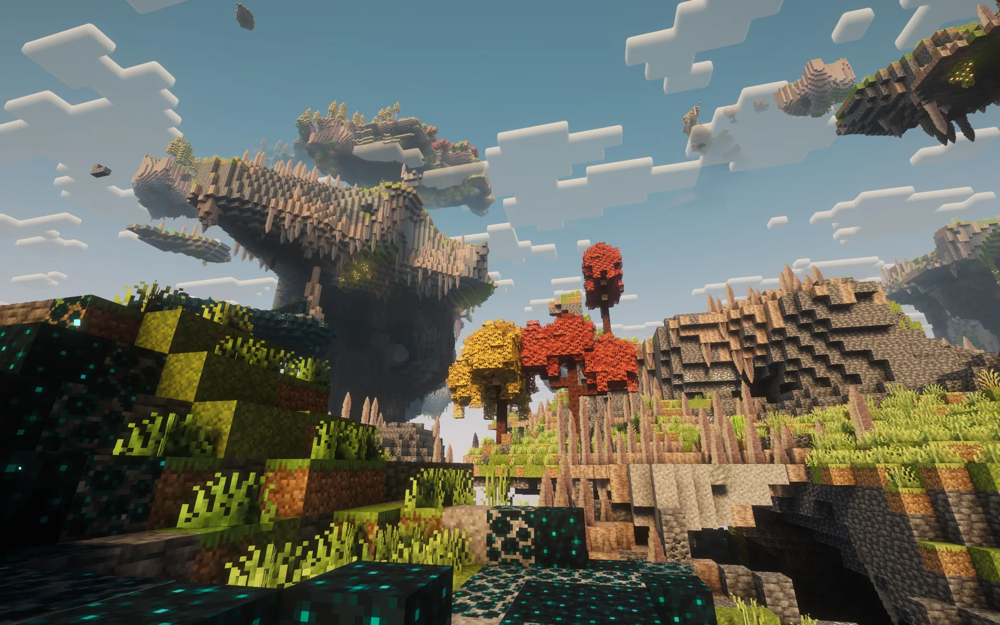
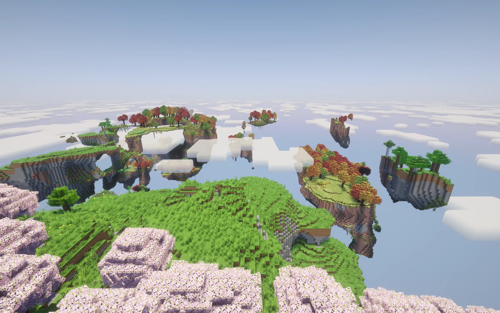
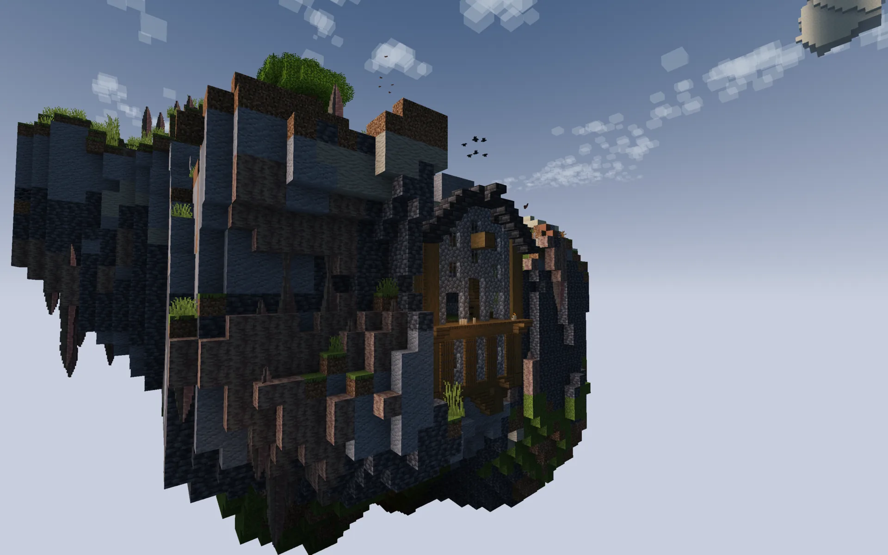

# Aeroscapes Reimagine

[Read in English](README.md)

<!-- summary: Соберите воздушный корабль в Create Aeronautics, исследуйте парящие острова и обустройте дом в небе. -->

<!-- description:start -->

**Постройте корабль. Пересеките море облаков. Найдите новый дом.**

Одиночное выживание в Minecraft с **Create** и **Create Aeronautics** в мире парящих островов.

## 🧭 Исследуйте острова

- 🏝️ **Мир над пустотой.** Ищите леса, засушливые острова, пещеры и деревни над отвесными обрывами.
- 🪝 **Спуститесь на планере или заберитесь по тросу.** Поймайте восходящий поток, зацепитесь за скалу и добывайте руду прямо с верёвки.
- 🏕️ **Идите на дым.** Иногда в лагере разведчиков есть указатель к рудной жиле. Дальше по пути можно найти руины или забраться на брошенный корабль.

## 🛠️ Соберите механизмы и поднимитесь в небо

- 🛩️ **Летайте на корабле, который построили сами.** Соберите по блокам лёгкий разведчик или грузовой дирижабль. Проверьте подъёмную силу, загрузите припасы и выберите место посадки.
- ⚙️ **Запустите мастерскую Create.** Автоматизируйте выпуск нужных деталей и поручите механизмам часть работы по подготовке к вылету.
- 🐋 **Возьмите на борт камеру.** Высматривайте небесных китов и фотографируйте их для Небесного фотожурнала.

## 🌿 Обустройте свой остров

- 🍲 **Вырастите, приготовьте и возьмите с собой.** Скрещивайте культуры, готовьте в Farmer’s Delight и запасайте еду к следующему вылету.
- 🪚 **Постройте дом в скале.** Обустройте жилище или мастерскую с разными породами дерева, мебелью и деталями, которые можно вырезать под нужную форму.
- ✨ **Развивайте то, чем занимаетесь.** Выберите расу и класс, тренируйте навыки на практике, перековывайте снаряжение и изучайте заклинания по найденным свиткам.

**Minecraft Java Edition 1.21.1 · NeoForge · Java 25.** Начните новый мир с типом «По умолчанию». [Скачать сборку](https://github.com/ALittleMoron/aeroscapes-reimagine/releases) · [Установка](docs/ru/install.md)

Reimagine вырос в самостоятельный проект на основе части данных Isabel’s Aeroscapes. Otherworld D&D послужила ориентиром для развития персонажа, боя и магии. [Isabel’s Aeroscapes](https://modrinth.com/modpack/aeroscapes) · [Otherworld D&D](https://www.curseforge.com/minecraft/modpacks/otherworld-dnd) · [Авторы и лицензии](docs/ru/credits.md)

<!-- description:end -->

[Документация](docs/ru/index.mdx) · [Галерея](docs/ru/gallery.mdx) · [История изменений](docs/ru/changelog.md) · [Предложить идею](docs/ru/suggestions.md) · [Руководство разработчика](CONTRIBUTING.md)

[Сообщить об ошибке или предложить улучшение](https://github.com/ALittleMoron/aeroscapes-reimagine/issues/new/choose) · [Доска проекта](https://github.com/users/ALittleMoron/projects/3)

Автор определяет направление проекта и принимает изменения. ИИ помогает проверять идеи, исследовать вопросы Minecraft-моддинга и проводить ревью кода и сборки. [ИИ и авторство](docs/ru/ai-manifesto.md)
