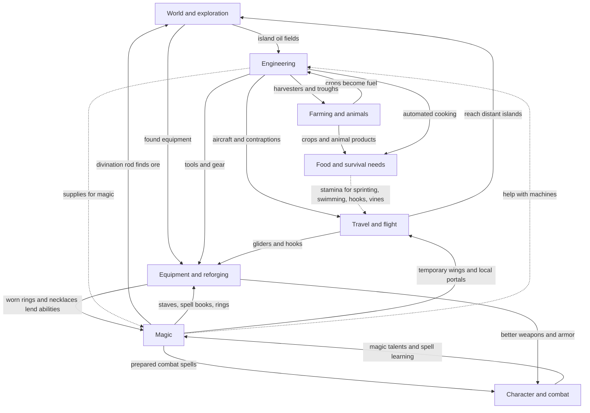
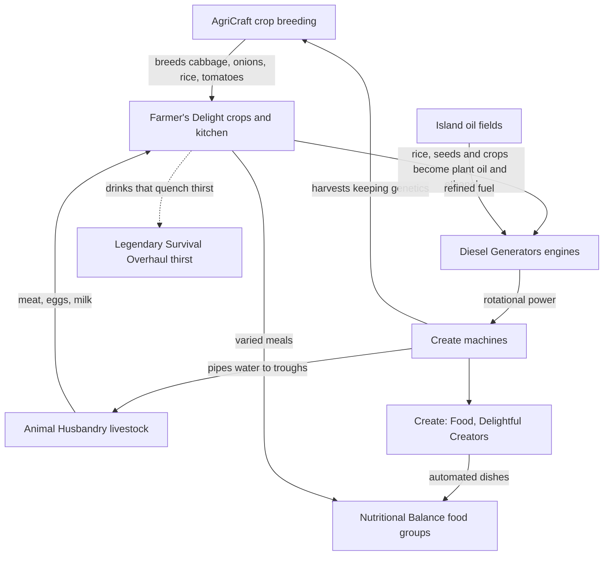

Each system in the pack can be played on its own. Learning several of them makes the others easier: a farm can fuel engines, a workshop can automate a kitchen, and equipment from any system can be reforged. Solid arrows show connections that work in the current pack. Dashed arrows show planned connections that are ideas for later releases, not finished features.

## Overview

Engineering sits at the centre: it powers flight, farming and kitchens and draws fuel from both crops and oil. Equipment from every direction can be reforged at an anvil, as [character and combat](../character-and-combat/) explains. Building and the [convenience features](../quality-of-life/) support all of these without depending on them.

## Food, farming and fuel

A garden can start the first engines before you find oil. The [fuel guide](../engineering/fuel/) covers presses, fermentation and refining; [cooking and farming](../building-and-daily-life/food/) covers crop breeding, livestock, food groups and drinking water.

## Planned connections

The dashed arrows describe the intended direction, not a release schedule. Stamina from gliding is meant to become a shared resource for sprinting, swimming, hanging on a grappling hook and climbing vines, with food affecting it. Magic and engineering are meant to support each other, so a player studying both learns each more comfortably. Drinks from the kitchen are meant to quench thirst. Bred plants and discoveries during exploration are also meant to help in other systems; their arrows will appear on this map once concrete connections are chosen.
