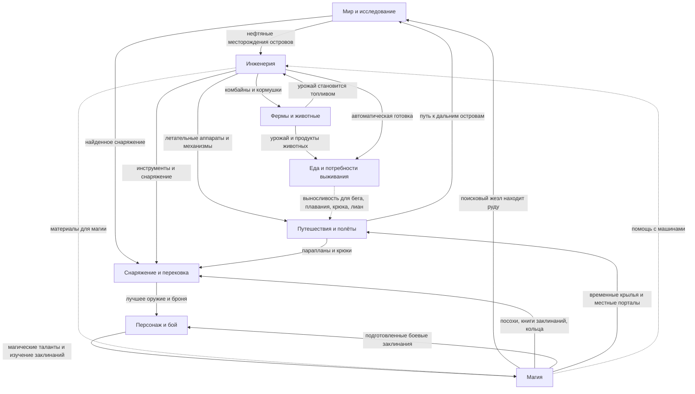
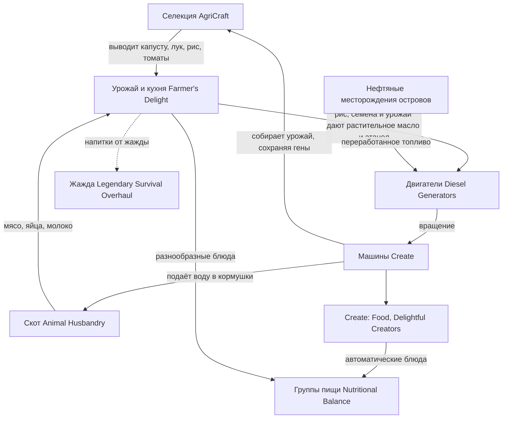

В каждую систему сборки можно играть отдельно. Если освоить несколько, остальные становятся проще: ферма даёт топливо двигателям, мастерская автоматизирует кухню, а снаряжение из любой системы можно перековать. Сплошные стрелки показывают связи, которые уже работают в сборке. Пунктирные — запланированные связи: это идеи для следующих релизов, а не готовые возможности.

## Общая схема

Инженерия находится в центре: она двигает полёты, фермы и кухни, а топливо получает и из урожая, и из нефти. Снаряжение из любого направления можно перековать на наковальне — подробнее на странице [«Персонаж и бой»](../character-and-combat/). Строительство и [удобства игры](../quality-of-life/) поддерживают все эти системы, но от них не зависят.

## Еда, фермы и топливо

Огород может запустить первые двигатели ещё до того, как найдётся нефть. Пресс, брожение и переработку описывает [руководство по топливу](../engineering/fuel/), а селекцию, скот, группы пищи и питьевую воду — страница [«Еда и фермерство»](../building-and-daily-life/food/).

## Запланированные связи

Пунктирные стрелки показывают задуманное направление, а не расписание релизов. Выносливость параплана должна стать общим ресурсом для бега, плавания, виса на крюке и лазания по лианам, а еда — влиять на неё. Магия и инженерия должны поддерживать друг друга, чтобы игроку, который изучает обе, было проще осваивать каждую. Напитки с кухни должны утолять жажду. Выведенные растения и находки во время исследования тоже должны помогать в других системах; их стрелки появятся на схеме, когда будут выбраны конкретные связи.
